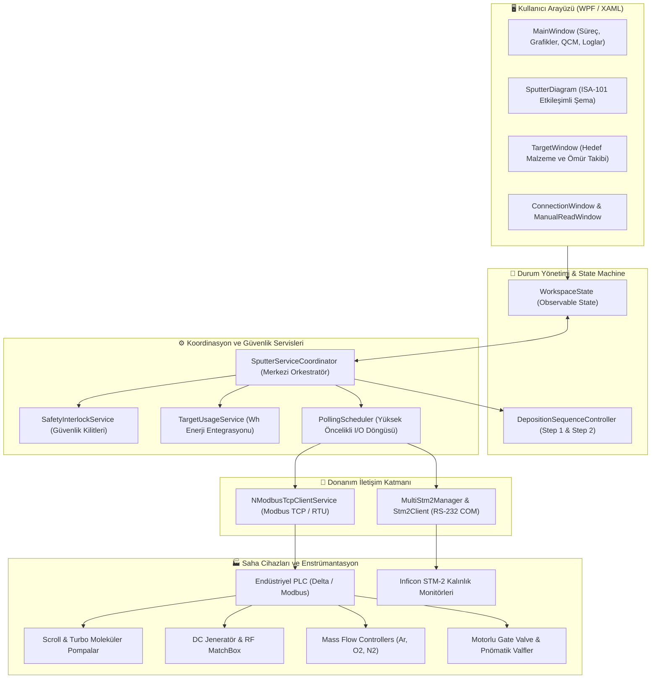

# ⚡ SputterNewApp — Endüstriyel Magnetron Sputtering Kontrol Sistemi

<div align="center">

[](https://dotnet.microsoft.com/)
[](https://docs.microsoft.com/en-us/dotnet/csharp/)
[](https://microsoft.com)
[](https://modbus.org/)
[](https://www.inficon.com/)
[](https://scottplot.net/)
[](https://github.com/ClosedXML/ClosedXML)
[](https://github.com/AliFurkanOZ)

**Modern, Güvenilir ve Yüksek Hassasiyetli PVD (Fiziksel Buhar Biriktirme) İnce Film Kaplama Otomasyon Yazılımı**

*Endüstriyel PLC entegrasyonu, gerçek zamanlı ISA-101 P&ID süreç şeması, çift RF ve DC plazma katot kontrolü, in-situ QCM film kalınlık izleme ve donanımsal interlock güvenlik mimarisi.*

[Özellikler](#-öne-çıkan-özellikler) • [Mimari](#-sistem-mimarisi) • [P&ID Şeması](#-etkileşimli-pid-hmi-şeması) • [QCM Kalınlık İzleme](#-in-situ-qcm-ve-inficon-stm-2-entegrasyonu) • [Güvenlik Kilitleri](#-donanımsal-güvenlik-ve-interlock-mimarisi) • [Kurulum](#-kurulum-ve-başlatma) • [Geliştirici](#-geliştirici--iletişim)

---

</div>

## 📖 Proje Hakkında

**SputterNewApp**, gelişmiş AR-GE laboratuvarları ve endüstriyel ince film kaplama tesislerinde kullanılan **Magnetron Püskürtme (Magnetron Sputtering - PVD)** sistemlerinin hassas kontrolü ve izlenmesi amacıyla **.NET 10 (WPF)** altyapısında geliştirilmiş yeni nesil bir **SCADA / HMI** masaüstü uygulamasıdır.

Yazılım; yüksek vakum odasındaki basınç rejimlerini, gaz akışlarını (MFC), plazma deşarj güç kaynaklarını (DC, RF1, RF2), kristal osilatör tabanlı in-situ kaplama hızı ölçümünü (QCM), altlık ısıtma/rotasyon birimlerini ve çok kademeli emniyet kilitlerini tek bir merkezden eşzamanlı olarak yönetir.

---

## ✨ Öne Çıkan Özellikler

### 1. 🎛️ Çoklu Katot & Güç Kaynağı Kontrolü (DC / RF1 / RF2)
* **DC Kaynağı:** Akım (mA) veya Güç (W) modlarında çalışma; ayarlanabilir gerilim/akım limitleri, rampa hızları (`mA/s` veya `W/s`) ve güvenli kapanma (`Off-Ramp`).
* **Çift RF Kaynağı (RF1 & RF2):** 13.56 MHz RF güç jeneratörleri ve otomatik eşleme ünitesi (**MatchBox**) entegrasyonu; İleri Güç (*Forward Power*) ve Yansıyan Güç (*Reflected Power*) gerçek zamanlı takibi.
* **Otomatik 2 Kademeli Süreç Döngüsü (Two-Step Recipe Controller):**
  * **Step 1 (Presputter / Dağlama):** Hedef yüzeyini temizlemek için rampa, hedef güç ve bekleme süresi (*Dwell time*).
  * **Step 2 (Deposition / Kaplama):** Esas kaplama gücü, rampa ve bekleme süresi.
  * Anlık geriye kalan süre ve toplam süre hesabı; dinamik kalan zaman projeksiyonu.

### 2. 🌀 Akıllı Vakum ve Pompa Yönetimi
* **Ön Vakum (Scroll / Roughing Pump):** Kaba vakum hattı denetimi.
* **Yüksek Vakum (Turbo Moleküler Pompa - TMP / EVP):** Frekans (Hz) ve çalışma devri telemetrisi.
* **Motorlu Hassas Gate Valve:** %0 ile %100 arasında hassas oransal açıklık ayarı; dinamik durum kodu takibi (`4998 Açılıyor`, `4999 Kapanıyor`, `0 Durdu / Açık / Kapalı`).
* **Otomatik Vakum Rejimi Tespiti:**
  * 🌐 **Atmosfer Basıncı:** $\ge 1.0\text{ Torr}$
  * 🟡 **Kaba Vakum (Rough Vacuum):** $1.0\text{ Torr} \sim 10^{-4}\text{ Torr}$
  * 🔵 **Yüksek Vakum (High Vacuum):** $< 10^{-4}\text{ Torr}$ (Proses Başlatmaya Hazır)
* Valf Matrisi: *Bypass, Roughing, Vent, Soft Turbo, Transfer ve Çember Havalandırma* valflerinin güvenli sıralı yönetimi.

### 3. 🧪 MFC Hassas Kütle Akış Kontrolü (Mass Flow Controllers)
* Çember içerisine beslenen reaktif ve soy gazların (Argon - Ar, Oksijen - $O_2$, Azot - $N_2$) bağımsız MFC kanalları üzerinden kontrolü.
* Anlık debi (`sccm`), hedef set değeri, tam skala kalibrasyonu (*Full Scale*) ve gaz endeksi register yönetimi.

### 4. 💎 In-Situ QCM Kalınlık ve Hız İzleme (Inficon STM-2 Entegrasyonu)
* **Çoklu STM-2 Sensör Desteği:** Her katot (DC, RF1, RF2) için ayrı STM-2 kalınlık monitörü desteği.
* **Otomatik Port Keşfi (Serial COM Auto-Discovery):** Boştaki seri portları arka planda otomatik tarayarak cihaz seri numaralarını (S/N) tespit eder; bağlantı kopsa bile kullanıcı müdahalesine gerek kalmadan yeniden bağlanır.
* **Malzeme Akustik Parametreleri:** Malzeme yoğunluğu (*Density*), Z-Oranı (*Z-Ratio*), Tooling faktörü ve sıfırlama (*Zero Thickness*) kalibrasyonları.
* Kristal ömrü (*Crystal Life %*), kaplama büyüme hızı ($\text{Å/s}$) ve toplam biriken kalınlık ($\text{kÅ / nm}$) gerçek zamanlı telemetrisi.

### 5. 🛡️ Donanımsal Güvenlik ve Interlock Mimarisi
* **Chiller Güvenlik Kilidi:** Katot soğutma suyu ve turbo soğutması devrede değilken DC/RF kaynaklarının ve Turbo pompanın açılması donanımsal olarak engellenir.
* **MatchBox Koruma Kilidi:** RF güç kaynakları çalışırken MatchBox ünitesinin kapatılması engellenir; RF güçlerinin kapatılmasını zorunlu tutar.
* **Acil Stop (Emergency Stop) Entegrasyonu:** PLC register 350 üzerinden Acil Stop basıldığında tüm güç kaynakları, gaz akışları ve tehlike arz eden valfler anında güvenli konuma çekilir.

### 6. 📚 Hedef (Target) ve Malzeme Kütüphanesi
* **1200+ Hazır Malzeme Veritabanı:** `seed_materials.json` üzerinden element ve bileşiklerin teorik yoğunluk ve Z-Ratio katsayıları otomatik yüklenir.
* **Wh / kWh Kümülatif Enerji ve Erozyon Takibi:** Katotta harcanan güç ve çalışma süresi saniye saniye entegre edilerek `Watt-Saat (Wh)` cinsinden hedef tüketimi ve erozyon ömrü kaydedilir (`TargetUsageService`).

### 7. 📈 Yüksek Performanslı ScottPlot Grafikleri & Raporlama
* **60 FPS Akıcı Grafikler:** ScottPlot 5 altyapısı ile çember basıncı, film büyüme hızı, kalınlık ve sıcaklık trendleri gerçek zamanlı çizdirilir.
* **ClosedXML ile Excel Dışa Aktarımı:** Tüm proses adımları, kullanıcı müdahaleleri, alarm olayları ve telemetri verileri `.xlsx` formatında raporlanır.

---

## 🏛️ Sistem Mimarisi

Uygulama, endüstriyel güvenilirlik ve yüksek tepki süresi hedeflenerek gevşek bağlı (loosely-coupled), asenkron ve modüler bir mimari ile inşa edilmiştir:



---

## 🗺️ Modbus PLC Register Haritası Özeti

Sistem, endüstriyel PLC holding register adresleri üzerinden 16-bit tamsayılar ve 32-bit kayan noktalı (Float32, CDAB byte sıralı) verilerle haberleşir:

| Adres Aralığı | Alt Sistem / Fonksiyon | Açıklama |
| :--- | :--- | :--- |
| `0 - 9` | **DC Güç Kaynağı Kontrolü** | Start/Stop, Step 1 & 2 Set (W), Rampa, Bekleme (Dwell), Voltaj/Akım |
| `10 - 89` | **MFC Gaz Akış Kontrolü (1 - 5)** | Anlık Debi, Set Noktası, Full Scale, Gaz Endeksi, Valf Aç/Kapa |
| `100 - 114` | **Manuel Başlatma Komutları** | Rotasyon, Isıtıcı, RF1/RF2/DC Güçleri, MatchBox, Pompalar, Shutter'lar |
| `123 - 128` | **Vakum Göstergeleri** | Çember Basıncı (Torr / Analog Voltaj Float32 CDAB) |
| `130 - 141` | **RF1 Güç Kaynağı Kontrolü** | Start/Stop, Step 1 & 2 Set (W), Rampa, Bekleme, İleri/Yansıyan Güç |
| `150 - 154` | **Gate Valve & Motor Geri Bildirimi**| Konum (%0-100), Hız, Durum Kodu (4998: Açılıyor, 4999: Kapanıyor) |
| `160 - 222` | **DC Kaynağı Detaylı Telemetri** | Anlık V/I/P okumaları, çalışma modları, limitler ve rampalar |
| `230 - 276` | **QCM Kalınlık ve Hız Verileri** | STM-2 Kalınlık, Hız, Kristal Ömrü, Z-Ratio, Yoğunluk, Tooling |
| `280 - 291` | **RF2 Güç Kaynağı Kontrolü** | RF2 Start/Stop, Step 1 & 2 Set (W), Rampa, Dwell, İleri/Geri Güç |
| `292 - 295` | **Altlık Isıtıcı (Ordel Kontrol)** | PID Set Sıcaklığı, Anlık Sıcaklık (°C) |
| `350` | **Acil Stop (Emergency Stop)** | 0: Normal, 1: Acil Stop Basılı |

---

## 🖥️ Etkileşimli P&ID HMI Şeması

Uygulamanın **Sputter Şeması** sekmesi, uluslararası **ISA-101 (Yüksek Performanslı HMI)** standartlarına göre tasarlanmış dinamik bir borulama ve enstrümantasyon diyagramıdır (P&ID):

* **Çift Modlu Çalışma:**
  * 👁️ **İzleme Modu (View Mode):** Operatörün yanlışlıkla valflere veya motorlara dokunmasını engelleyen güvenli görselleştirme modu.
  * ⚙️ **Kumanda Modu (Control Mode):** Yetkili operatörün şema üzerinden valfleri, shutter'ları ve pompaları doğrudan açıp kapatabildiği etkileşimli mod.
* **Görselleştirilmiş Vakum Durumları:**
  * Çemberin iç dolgusu anlık basınca göre renk değiştirir: Yüksek vakuma inildiğinde berrak mavi bir derinlik kazanır, atmosferde ise nötr çelik grisine döner.
* **Plazma Simülasyonu:**
  * Katot jeneratörü aktifleştiğinde ve ilgili mekanik **shutter** açıldığında, altlık üzerine odaklanan ışıma animasyonu başlar:
    * **RF Kaynakları:** Mor ve camgöbeği ışıma gradyanı (`RfPlasmaGlow`).
    * **DC Kaynağı:** Kehribar ve altın sarısı ışıma gradyanı (`DcPlasmaGlow`).
* **Canlı Motor & Turbo Animasyonları:**
  * Altlık tablası rotasyona girdiğinde (RPM > 0) dönüş göstergeleri ve Turbo Pompa frekansı 5 Hz'i aştığında dinamik hız halkaları devreye girer.

---

## 💎 In-Situ QCM ve Inficon STM-2 Entegrasyonu

İnce film biriktirmede kalınlık doğruluğu en kritik parametredir. `SputterNewApp`, endüstri standardı **Inficon STM-2** cihazlarıyla tam entegredir:

```
[Inficon STM-2 Sensor] --(RS-232 / USB COM)--> [MultiStm2Manager]
                                                       │
               ┌───────────────────────────────────────┴───────────────────────────────────────┐
               ▼                                       ▼                                       ▼
       [DC QCM Modülü]                         [RF1 QCM Modülü]                        [RF2 QCM Modülü]
  • Anlık Hız (Å/s)                       • Anlık Hız (Å/s)                       • Anlık Hız (Å/s)
  • Kalınlık (kÅ / nm)                    • Kalınlık (kÅ / nm)                    • Kalınlık (kÅ / nm)
  • Kristal Sağlığı (%)                   • Kristal Sağlığı (%)                   • Kristal Sağlığı (%)
```

* **Dinamik COM Port Taraması:** Windows işletim sisteminde takılı olan tüm seri portlar 115200 ve 9600 baud hızlarında paralel sorgulanır (`TryGetSNAsync`).
* Cihaz seri numarası tespit edildiği anda doğru katot kanalına otomatik olarak bağlanır.
* Kristal değişim ihtiyacında operatör ekrandan kristal sağlık yüzdesini (% Life) anlık olarak görebilir.

---

## 🚀 Kurulum ve Başlatma

### Gereksinimler
* **İşletim Sistemi:** Windows 10 / Windows 11 (64-bit)
* **Geliştirme Ortamı & SDK:** [.NET 10.0 SDK](https://dotnet.microsoft.com/download/dotnet/10.0) veya üzeri
* **IDE:** Visual Studio 2026 / Visual Studio 2022 (v17.12+) veya Visual Studio Code (.NET C# Dev Kit ile)
* **Donanım Bağlantısı:**
  * Modbus TCP için Ethernet bağlantısı (örn. `192.168.1.5:502`)
  * STM-2 QCM için RS-232 to USB dönüştürücü kablolar

### Projeyi Klonlama ve Çalıştırma

```bash
# Depoyu klonlayın
git clone https://github.com/AliFurkanOZ/Sputter.git
cd Sputter/SputterNewApp

# Bağımlılıkları geri yükleyin
dotnet restore

# Projeyi derleyin
dotnet build -c Release

# Uygulamayı başlatın
dotnet run -c Release
```

### Yapılandırma Dosyaları
Uygulama ilk açılışta `AppData` klasöründe kullanıcı profili oluşturur (`%AppData%\SputterNewApp\Users\default\`):
* `connection.json`: Modbus TCP IP adresi, port, kayıt numarası ve unit ID.
* `materials.json`: Kullanıcı tarafından özelleştirilmiş malzeme listesi.
* `targets.json`: Katotlara takılı hedef materyaller ve harcanan enerji (Wh) kayıtları.

---

## 📂 Proje Dizin Yapısı

```plaintext
SputterNewApp/
├── Controls/                   # Özel UI bileşenleri ve çizim kontrolleri
│   ├── PreviewChart.cs         # Vektörel önizleme grafiği
│   ├── RangeBar.cs             # Oransal çubuk bileşeni
│   ├── SourceCard.xaml         # DC / RF1 / RF2 Katot kontrol kartı
│   ├── ValueReadout.xaml       # Ölçüm ve birim göstergesi
│   └── ValveIndicator.xaml     # Valf durum göstergesi
├── Core/                       # Çekirdek modeller ve soyutlamalar
│   ├── Helpers/                # Modbus float/endian dönüştürücüler
│   ├── Models/                 # MaterialItem, TargetItem, ProcessItem, LayerItem
│   ├── Registers/              # RegisterMap.cs (PLC adres tablosu)
│   └── Services/               # UserStorage ve arayüz sözleşmeleri
├── Infrastructure/             # Donanım sürücüleri ve haberleşme
│   ├── Logging/                # LogService (Olay ve hata günlükleme)
│   ├── Modbus/                 # NModbusTcpClientService
│   └── Serial/                 # Stm2Client & MultiStm2Manager (RS-232)
├── Models/                     # MVVM durum sınıfları
│   ├── PreviewData.cs          # Önizleme veri modelleri
│   └── WorkspaceState.cs       # Merkezi reaktif durum motoru
├── Seed/                       # Başlangıç veritabanı şablonları
│   ├── seed_materials.json     # 1200+ element/bileşik akustik parametreleri
│   └── seed_targets.json       # Varsayılan katot hedefleri
├── Services/                   # Süreç mantığı ve iş kuralları
│   ├── DepositionSequenceController.cs # Presputter & Deposition aşama kontrolörü
│   ├── PollingScheduler.cs     # Eşzamansız donanım yoklama planlayıcısı
│   ├── SafetyInterlockService.cs       # Donanımsal kilit ve güvenlik kuralları
│   ├── SputterServiceCoordinator.cs    # Merkezi servis yöneticisi (110+ KB)
│   └── TargetUsageService.cs   # Hedef enerji entegrasyonu (Wh)
├── Styles/                     # XAML tema, renk paleti ve fırçalar
├── Views/                      # Uygulama pencereleri ve kullanıcı ekranları
│   ├── ConnectionWindow.xaml   # PLC & QCM bağlantı paneli
│   ├── EditorWindow.xaml       # Reçete ve katman düzenleme sihirbazı
│   ├── ManualReadWindow.xaml   # Mühendislik register teşhis ekranı
│   ├── SputterDiagram.xaml     # ISA-101 Etkileşimli P&ID Şeması
│   └── TargetWindow.xaml       # Hedef kütüphanesi ve erozyon yöneticisi
├── MainWindow.xaml             # Ana çalışma istasyonu ekranı
└── SputterNewApp.csproj        # Proje konfigürasyonu ve NuGet paketleri
```

---

## 📦 Kullanılan Teknolojiler ve Kütüphaneler

| Teknoloji | Sürüm | Kullanım Amacı |
| :--- | :--- | :--- |
| **Microsoft .NET** | `10.0-windows` | En güncel C# 13 ve yüksek performanslı masaüstü çalışma zamanı |
| **WPF (Windows Presentation Foundation)** | Core | XAML tabanlı donanım hızlandırmalı zengin kullanıcı arayüzü |
| **NModbus** | `3.0.81` | Endüstri standardı Modbus TCP ve Modbus RTU protokol uygulaması |
| **ScottPlot.WPF** | `5.1.57` | Gerçek zamanlı yüksek FPS grafik çizim motoru |
| **ClosedXML** | `0.105.0` | Proses loglarını ve kalite raporlarını Excel (.xlsx) formatında üretme |
| **System.IO.Ports** | `10.0.2` | Inficon STM-2 QCM kalınlık monitörleri için RS-232 seri port yönetimi |

---

## 🔒 Güvenlik Uyarıları ve Saha Notları

> [!WARNING]
> **Yüksek Gerilim ve RF Radyasyonu:** Sputtering sistemleri ölümcül olabilecek DC yüksek gerilimleri ($>500\text{ V}$) ve yüksek güçlü RF radyasyonunu ($13.56\text{ MHz}$) içerir. Yazılımdaki `SafetyInterlockService` kontrollerini manuel olarak devre dışı bırakmayınız.

> [!IMPORTANT]
> **Su Soğutma (Chiller) Zorunluluğu:** Magnetron katotları ve Turbo Moleküler Pompa yeterli soğutma suyu debisi olmadan çalıştırılırsa kalıcı donanım hasarı meydana gelebilir. Sistemde Chiller geri bildirimi aktifleşmeden hiçbir plazma kaynağı ateşlenemez.

---

## 👨‍💻 Geliştirici & İletişim

* **Geliştirici:** Ali Furkan ÖZ
* **GitHub:** [@AliFurkanOZ](https://github.com/AliFurkanOZ)
* **Proje Deposu:** [AliFurkanOZ/Sputter](https://github.com/AliFurkanOZ/Sputter)

---

## 📄 Lisans

Bu proje özel bir endüstriyel Ar-Ge çalışması kapsamında **Ali Furkan ÖZ** tarafından geliştirilmiştir. Tüm hakları saklıdır.

---

<div align="center">
  <sub>Gelişmiş İnce Film ve Plazma Teknolojileri İçin Sevgi ve Mühendislikle Tasarlandı.</sub>
</div>
